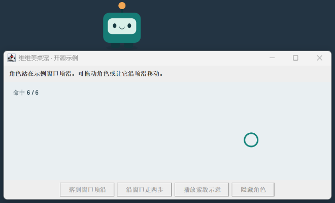

# 维维美桌宠

**当前公开内容：桌宠核心技术预览版**

拟发布版本为 `v0.1.0-core-preview`，是一个可独立构建的 Windows 桌宠基础工程。它基于 Harry Huang 与 Ark-Pets 贡献者的作品。本项目为非官方同人技术项目，不代表游戏开发商或发行商。[Ark-Pets v3.13.1](https://github.com/isHarryh/Ark-Pets/tree/v3.13.1)



## 技术内容

| 功能 | 可验证范围 |
| --- | --- |
| 窗口顶沿支撑与碰撞 | 示例把自己的普通 Windows 窗口作为支撑面，可落到顶沿并沿顶沿行走。 |
| 角色重力、移动与落地 | 共用核心物理和运动状态机，示例可拖动角色并观察落地。 |
| 办公活动区域与自主行为 | 核心模块包含活动区域、动作权重和冷却策略，并有测试。示例通过按钮演示移动。 |
| 六次命中与目标锁定 | Swing 示例绘制索敌、锁定和命中状态，六次命中均使用程序几何图形。 |
| Windows 桌面交互 | 示例使用独立浮窗，支持拖动、隐藏和显示，使用单独的存档目录。 |
| 原创示例角色 | 角色由 Java 2D 几何图形绘制，截图来自 Windows 实机。 |

个人完整版 `ViviMePet v1.0.2` 属于单独的本地构建。本次范围排除其安装包、完整桌宠界面、游戏模型和动画、Unity 原始或烘焙效果，以及 Spine 集成运行时。[素材政策](ASSET_POLICY.md) · [运行时边界](docs/RUNTIME_BOUNDARY.md)

## Windows 快速开始

准备 Windows 10 或 11 的图形桌面和 JDK 17，并让 `JAVA_HOME` 指向 JDK。Windows 实机验证见 [构建说明](BUILD.md)。第一次构建需要从 Gradle 和 Maven Central 获取构建依赖。

```powershell
.\gradlew.bat --no-daemon :core:test :desktop:build :desktop:installDist
.\desktop\build\install\ViviMe-Desktop-Pet\bin\ViviMe-Desktop-Pet.bat
```

打开示例后，拖动浮动角色，或点击「落到窗口顶沿」再点击「沿窗口走两步」。索敌示意使用可见的几何环与命中状态，节奏为示例所用。需要额外授权的资源由 [边界说明](docs/RUNTIME_BOUNDARY.md) 记录。

## 代码与来源

| 路径 | 内容 |
| --- | --- |
| `core` | 上游物理及顶沿遮挡算法、维维美落地与返岗状态、位置存档、动作策略、目标锁定、Swing 战斗菜单与程序化音效、无素材测试 |
| `desktop` | Windows 上运行的 Swing 示例、独立顶沿支撑、原创角色、启动与桌面冒烟检查 |
| `scripts` | 提交对象、整个 Git 对象库及本地构建产物检查 |

维维美新增了办公动作策略、窗口顶沿修正、短音合成、定序攻击和准星命中状态。此候选只合入可在独立示例中完整构建和回归的代码范围。保留 Harry Huang 与各源文件的原作者声明。项目源代码使用 [GPL-3.0](LICENSE)，第三方组件见 [许可证清单](THIRD_PARTY_LICENSES.md)。
